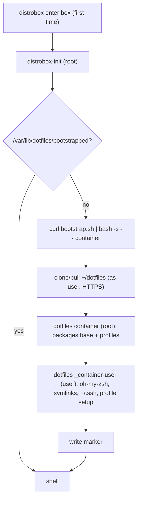

# dotfiles

My personal setup for **Fedora Workstation (GNOME)** and for **distrobox** containers.

It covers two use cases:

1. **New machine.** Go from a fresh Fedora install to my full setup (packages, flatpaks, shell, GNOME settings and extensions, distroboxes) with one command.
2. **Distroboxes.** Every distrobox configures itself **unattended on first start**. It uses its own clone of this repo inside its own home, and nothing is shared with the host except a **read-only** `~/.ssh`. This part works on Fedora, Ubuntu/Debian, Arch, openSUSE and Alpine based images.

No chezmoi or other dotfile manager is involved, only `bash` + `git`. Files in [`home/`](home/) are **symlinked** into `$HOME`, so editing `~/.zshrc` edits the repo file, ready to commit.

---

## Contents

- [Quick start](#quick-start)
- [Repository layout](#repository-layout)
- [The `dotfiles` command](#the-dotfiles-command)
- [Host setup (use case 1)](#host-setup-use-case-1)
- [Distrobox setup (use case 2)](#distrobox-setup-use-case-2)
- [Everyday tasks](#everyday-tasks)
- [How it works](#how-it-works)
- [Troubleshooting](#troubleshooting)

---

## Quick start

**Fresh Fedora host**:

```bash
curl -fsSL https://raw.githubusercontent.com/Tsagae/dotfiles/main/bootstrap.sh | bash -s -- host
```

or, equivalently:

```bash
git clone https://github.com/Tsagae/dotfiles ~/dotfiles
~/dotfiles/dotfiles host
```

**Distroboxes**, from the host:

```bash
dotfiles boxes create                     # create every box in distrobox/distrobox.ini
distrobox enter dev-rust                  # first start: it sets itself up, then you're in
```

**Any other existing container**, run inside it:

```bash
curl -fsSL https://raw.githubusercontent.com/Tsagae/dotfiles/main/bootstrap.sh | bash -s -- container [profile...]
```

---

## Repository layout

```
dotfiles/
├── dotfiles                 # the CLI (entrypoint for everything)
├── bootstrap.sh             # curl-able: clone/update ~/dotfiles, then run `dotfiles <host|container>`
├── home/                    # mirrored into $HOME as symlinks
│   ├── .zshrc
│   ├── .gitconfig
│   └── .config/micro/{settings,bindings}.json
├── packages/
│   └── base.txt             # CLI tools installed everywhere (host + all boxes)
├── host/                    # host-only (Fedora GNOME)
│   ├── packages.txt         # extra dnf packages (steam, chrome, gnome-tweaks, distrobox…)
│   ├── flatpaks.txt         # Flathub app IDs
│   ├── gnome-extensions.txt # extension UUIDs
│   ├── dconf-paths.txt      # which dconf dirs/keys are tracked
│   └── dconf.ini            # tracked GNOME settings (keybindings, dash favourites)
├── distrobox/
│   ├── Containerfile.fedora # local Fedora base image (pre-installs packages/base.txt)
│   └── distrobox.ini        # box definitions (distrobox-assemble format)
├── profiles/                # optional extras for boxes
│   ├── dev/                 # JDK + OpenGL libs (every dev-* box)
│   ├── go/                  # golang + GOPATH
│   ├── rust/                # gcc + rustup
│   └── cpp/                 # cmake, g++, glfw, assimp, glm, benchmark…
└── lib/                     # implementation (bash)
```

---

## The `dotfiles` command

```
dotfiles host [step...]           Full host setup, or only the given steps
dotfiles container [profile...]   Distrobox setup (normally run automatically)
dotfiles link                     (Re)create the symlinks from home/ into $HOME
dotfiles update                   git pull + link
dotfiles gnome dump               Save tracked GNOME settings into host/dconf.ini
dotfiles gnome restore            Apply host/dconf.ini
dotfiles gnome extensions         Install the extensions from host/gnome-extensions.txt
dotfiles boxes build              Build the local Fedora base image with packages/base.txt
dotfiles boxes list               List the boxes in distrobox/distrobox.ini
dotfiles boxes create [name...]   Create missing boxes (all by default; builds image if needed)
dotfiles boxes replace [name...]  Destroy + recreate boxes (their homes are kept)
dotfiles help
```

Every step is **idempotent**, so it's always safe to re-run. `dotfiles` is automatically symlinked into `~/.local/bin/dotfiles` (which is in `$PATH`), so you can call `dotfiles` directly from anywhere.

---

## Host setup (use case 1)

Run as your normal user (not root). `sudo` is used where needed and asks for the password once at the start.

```bash
~/dotfiles/dotfiles host
```

Steps, in order (each one can also be run alone, e.g. `dotfiles host flatpaks gnome`):

| Step | What it does |
|---|---|
| `repos` | RPM Fusion free + nonfree, Cisco openh264, Google Chrome repo, COPR `dejan/lazygit` |
| `packages` | `dnf upgrade`, then installs `packages/base.txt` + `host/packages.txt` |
| `shell` | Clones oh-my-zsh + zsh-autosuggestions, symlinks `home/` into `$HOME` and `dotfiles` into `~/.local/bin`, sets zsh as the login shell |
| `flatpaks` | Enables Flathub, updates installed flatpaks, installs `host/flatpaks.txt` |
| `gnome` | `dconf load` of `host/dconf.ini` (keybindings, dash favourites) |
| `extensions` | Installs `host/gnome-extensions.txt` via `gnome-browser-connector`. **GNOME asks to confirm each extension**, so this is the only interactive step |
| `distrobox` | Makes sure `podman` + `distrobox` are installed and creates `~/distrobox-homes` |
| `boxes` | `dotfiles boxes create`: creates every box in `distrobox/distrobox.ini` |

When it finishes, **log out and back in** to pick up zsh and the GNOME settings.

> If the repo was cloned over HTTPS, its push URL is switched to `git@github.com:Tsagae/dotfiles.git` automatically, so `git push` works with your SSH key.

### Existing files

When a link would replace an existing file (e.g. a default `~/.zshrc`), the old file is moved to `~/.local/state/dotfiles/backup/<timestamp>/` first.

---

## Distrobox setup (use case 2)

### What a box gets

- **Its own home** in `~/distrobox-homes/<name>`.
- **Its own clone** of this repo at `~/dotfiles` *inside that home*. All symlinks (`~/.zshrc`, `~/.gitconfig`, `~/.config/micro/*`, `~/.zshrc.d/*`, `~/.local/bin/dotfiles`) point into this clone, not into the host's files.
- **`~/.ssh` → `/mnt/host-ssh`**, the host's `~/.ssh` bind-mounted **read-only**. This is the only thing shared with the host. Your keys work (and so does the host's ssh-agent socket), but nothing in the box can modify them.
- The packages from `packages/base.txt` + the box's profiles, installed with whatever package manager the image has.
- oh-my-zsh, zsh-autosuggestions, zsh as login shell, and the clone's push URL switched to SSH.

> [!NOTE]
> distrobox itself always mounts the real host home (`/home/<you>`) inside every container. The setup never reads or writes there, apart from the `.ssh` mount, but the files are reachable, so this is isolation by convention, not a sandbox.

### Unattended first start: how it works

`distrobox/distrobox.ini` has a base template `[_base]` for hooks and volume mounts, and `[_fedora]` which points to a local base image pre-built with [`packages/base.txt`](packages/base.txt):

```ini
[_base]
pre_init_hooks="export SHELL=/usr/bin/zsh"
volume="$HOME/.ssh:/mnt/host-ssh:ro"
init_hooks="test -e /var/lib/dotfiles/bootstrapped || curl -fsSL https://raw.githubusercontent.com/Tsagae/dotfiles/main/bootstrap.sh | bash -s -- container || echo '...'"

[_fedora]
include=_base
image=localhost/dotfiles-fedora:latest
pull=false
```

1. distrobox runs `init_hooks` **as root** at the end of container initialisation. Your first `distrobox enter` waits for it, and the progress shows in the output.
2. If the marker `/var/lib/dotfiles/bootstrapped` exists, nothing happens, so later starts cost nothing.
3. Otherwise `bootstrap.sh`:
   - installs `git`/`curl` if missing
   - clones this repo over **HTTPS** into `~/dotfiles` **as your user**. If the clone already exists, it does a `git pull --ff-only` instead.
   - runs `dotfiles container`. For Fedora boxes using `localhost/dotfiles-fedora:latest`, all base packages are already installed in the image layer, so package installation finishes in seconds. It then switches to your user to set up oh-my-zsh, the symlinks, `~/.ssh`, and any profile setup scripts.
   - writes the marker.
4. If something fails (e.g. no network), the container **still starts** and prints a message. Fix the problem and run `~/dotfiles/dotfiles container` by hand. The next start also retries, since the marker wasn't written.

### Profiles

Profiles are folders in [`profiles/`](profiles/). Each one may contain:

| File | Purpose |
|---|---|
| `packages.txt` | Extra packages (same cross-distro format as `packages/base.txt`) |
| `setup.sh` | Script run **as your user** (e.g. `rustup`) |
| `*.zsh` | Shell snippets, linked into `~/.zshrc.d/` and sourced by `.zshrc` (e.g. `GOPATH`) |

A box selects profiles with an environment variable in `distrobox.ini`:

```ini
[dev-rust]
include=_fedora
hostname=dev-rust
home=~/distrobox-homes/dev-rust
additional_flags="--env DOTFILES_PROFILES=dev,rust"
```

### Defined boxes

| Box | Image | Profiles | Notes |
|---|---|---|---|
| `fedorabox` | `dotfiles-fedora` (local) | none | General use. Exports `wol rsync tldr nmap` to the host's `~/.local/bin` |
| `ubuntubox` | `ubuntu-toolbox` (quay.io) | none | Ubuntu-based container |
| `dev-go` | `dotfiles-fedora` (local) | `dev,go` | |
| `dev-rust` | `dotfiles-fedora` (local) | `dev,rust` | |
| `dev-cpp` | `dotfiles-fedora` (local) | `dev,cpp` | |
| `dev-java` | `dotfiles-fedora` (local) | `dev` | The JDK comes from the `dev` profile |

### Creating, updating and deleting boxes

```bash
dotfiles boxes build                 # build/rebuild the local Fedora base image
dotfiles boxes create                # create all missing boxes (builds image if needed)
dotfiles boxes create dev-go         # just one
dotfiles boxes replace dev-go        # destroy + recreate: fresh system, same home
distrobox rm dev-go                  # delete the container (the home stays)
rm -rf ~/distrobox-homes/dev-go      # …and its home, for a completely clean start
```

> [!IMPORTANT]
> Always use `dotfiles boxes …` rather than plain `distrobox assemble create --file distrobox/distrobox.ini`. Plain `distrobox assemble` would also create a container for the `[_base]` template section.

**Updating config in boxes.** Boxes are meant to be throwaway: the setup runs only at creation/first start, and the way to update a box is to recreate it (`dotfiles boxes replace <name>`). Because the home survives, the recreated box pulls the latest version of the existing clone (`git pull --ff-only`) and sets itself up again from scratch. Delete the home as well for a completely fresh box. For a quick in-place update you can still run `dotfiles update` inside the box.

### Ad-hoc boxes (not in `distrobox.ini`)

Same behaviour with plain `distrobox create`:

```bash
distrobox create -n scratch -i quay.io/toolbx/arch-toolbox:latest \
  --home ~/distrobox-homes/scratch \
  --volume ~/.ssh:/mnt/host-ssh:ro \
  --pre-init-hooks "export SHELL=/usr/bin/zsh" \
  --init-hooks "test -e /var/lib/dotfiles/bootstrapped || curl -fsSL https://raw.githubusercontent.com/Tsagae/dotfiles/main/bootstrap.sh | bash -s -- container"
```

Or enter any box and run the curl one-liner from [Quick start](#quick-start) by hand.

---

## Everyday tasks

### Change a dotfile

Edit it in place (`micro ~/.zshrc`), then commit from the clone:

```bash
cd ~/dotfiles && git commit -am "zsh: ..." && git push
```

### Add a new dotfile

Put it under `home/` at the same relative path it should have in `$HOME`, then run `dotfiles link`. For example, `home/.config/foo/config.toml` becomes `~/.config/foo/config.toml`. To bring in an existing file:

```bash
mkdir -p ~/dotfiles/home/.config/foo
mv ~/.config/foo/config.toml ~/dotfiles/home/.config/foo/
dotfiles link
```

### Machine-specific shell config

Put it in `~/.zshrc.local`. It's sourced last and is **not** tracked.

### Add a package

- Everywhere (host + boxes): `packages/base.txt`
- Host only: `host/packages.txt`
- Some boxes only: a profile's `packages.txt`, or `additional_packages=` in the box's `distrobox.ini` section for Fedora-only packages

Format: one package per line, using the Fedora name. Add overrides for other package managers when the name differs, and use `-` to skip a package there:

```
procps-ng     apt=procps zypper=procps
hostname      pacman=inetutils apk=-
```

Packages that can't be installed are reported as warnings and don't stop the setup. Without a distro package, `lazygit` falls back to the upstream binary in `/usr/local/bin`.

### Add a flatpak or GNOME extension

Add the app ID to `host/flatpaks.txt` or the UUID to `host/gnome-extensions.txt`, then run `dotfiles host flatpaks` or `dotfiles gnome extensions`.

### Save GNOME settings

After changing keybindings or dash favourites on the host:

```bash
dotfiles gnome dump && git -C ~/dotfiles diff host/dconf.ini
```

To track more settings, add dconf paths to `host/dconf-paths.txt` (directories end with `/`, anything else is a single key) and dump again.

### Add a box

Add a section to `distrobox/distrobox.ini` (copy an existing one, `include=_base`), then `dotfiles boxes create <name>`.

### Add a profile

Create `profiles/<name>/` with any of `packages.txt`, `setup.sh`, `*.zsh`, then reference it in `DOTFILES_PROFILES`.

---

## How it works



- **Container detection:** `/run/.containerenv`, `/.dockerenv` or `$CONTAINER_ID`. `dotfiles host` refuses to run inside a container, and `dotfiles container` refuses to run on the host, unless you pass `--force`.
- **Target user when running as root:** the owner of `$HOME`. distrobox sets `$HOME` to the box's home during init. Override with `DOTFILES_USER`.
- **Package managers:** dnf, apt, pacman, zypper, apk.
- **Marker location:** the marker lives in the **container filesystem**, not in the home. That's why a recreated container (same home) sets itself up again.
- **Profiles in use** are recorded in `~/.local/state/dotfiles/profiles`, so `dotfiles link` / `dotfiles update` can re-link their snippets.

Environment overrides (mainly for testing/forks): `DOTFILES_REPO_URL`, `DOTFILES_BRANCH`, `DOTFILES_CLONE_DIR`, `DOTFILES_PUSH_URL`, `DOTFILES_USER`, `DOTFILES_PROFILES`, `HOST_SSH_MOUNT`.

---

## Troubleshooting

| Problem | Fix |
|---|---|
| Box started but has no config | Look at the init output (`podman logs <box>`), then run `~/dotfiles/dotfiles container <profiles>` inside the box |
| `ssh: Could not create directory ... known_hosts` / host key prompts | `~/.ssh` is read-only by design. Add the host to `known_hosts` **on the host**, or for a box-only entry put `UserKnownHostsFile ~/.ssh_known_hosts_box` in `~/.ssh_config_local`… or just connect once from the host |
| agnoster prompt shows broken glyphs | Install a Powerline/Nerd font and select it in the terminal |
| `Error cannot open display` for GUI apps from a box | On the host: `xhost +si:localuser:$USER` (put it in `~/.distroboxrc` to persist) |
| Want to redo the setup in a box | `sudo rm /var/lib/dotfiles/bootstrapped` and restart the box, or just `dotfiles boxes replace <name>` |
| `dotfiles boxes create` says the box exists | Use `dotfiles boxes replace <name>` |
